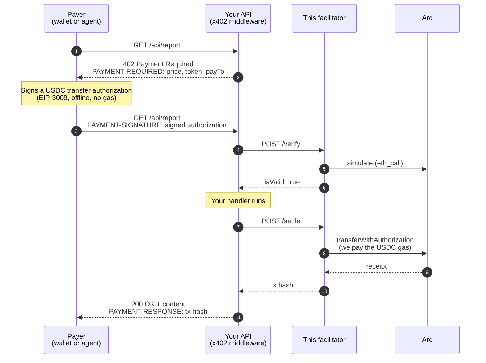

# arc-facilitator

**Let your API charge per request in USDC on Arc, without your customers ever spending a unit on gas.**

This is an [x402](https://docs.x402.org) facilitator for [Arc](https://docs.arc.io), Circle's Layer-1 for stablecoin finance. Your API asks for payment, the customer's wallet signs a message, and we put that payment on-chain and pay the fee out of our own balance. The customer only needs USDC.

Arc sharpens the usual x402 pitch, because on Arc **USDC is the gas token**. There is no second asset to acquire first and none for us to pay in either. The payer's USDC moves by exactly the amount they signed for; ours covers the fee. See [the decimal thing](#one-balance-two-interfaces) — it is the one Arc detail you cannot skip.

It ships with a documentation site, a public log of every payment, and a browser test page at `/test`.

| | |
| --- | --- |
| **Token** | USDC only, on both networks. It is also what gas is paid in. |
| **Networks** | Arc mainnet (`eip155:5042`) and Arc Testnet (`eip155:5042002`), both from one URL. Mainnet settlement ships behind a switch. |
| **Integration** | The official `@x402/*` packages, unchanged. You only change the facilitator URL. |
| **Custody** | None. Money goes straight from the payer to you. |

---

## Contents

- [How a payment works](#how-a-payment-works)
- [Architecture](#architecture)
- [Accept payments (merchants)](#accept-payments-merchants)
- [Pay for an API (agents and scripts)](#pay-for-an-api-agents-and-scripts)
- [Run your own facilitator](#run-your-own-facilitator)
- [API endpoints](#api-endpoints)
- [Supported token](#supported-token)
- [One balance, two interfaces](#one-balance-two-interfaces)
- [Safety limits](#safety-limits)
- [Project layout](#project-layout)
- [Testing](#testing)

---

## How a payment works



In plain words:

1. **Your API names a price.** An unpaid request gets `402` with the terms.
2. **The payer signs, but sends nothing.** Their wallet signs a message saying "move 0.01 USDC from me to this merchant". The message costs nothing, and because it is not a transaction there is no fee to pay.
3. **We check it, then submit it.** We confirm the signature and the balance, simulate the transfer, and send the transaction. We pay the gas.
4. **The USDC goes straight to you.** It never passes through us. The signature fixes the recipient, the amount, an expiry time and a one-time nonce, so all we can decide is whether to submit it.

Because gas on Arc is the same asset as the payment, "gasless" cannot be shown as a zero balance here — a paying account necessarily holds the gas token. The honest version is arithmetic: **the payer's balance falls by exactly the authorized amount, and not one unit more.** That is what `pnpm smoke` asserts and what `/test` displays.

---

## Architecture

```mermaid
flowchart LR
    subgraph Clients
        A[Payer<br/>@x402/fetch]
        B[Merchant API<br/>@x402/express · hono · next]
    end

    subgraph App["arc-facilitator (Next.js)"]
        direction TB
        R["x402 routes<br/>/verify · /settle · /supported<br/>/assets · /health"]
        G["guards.ts<br/>allowlist · dust floor<br/>rate limits · signer balance"]
        X["facilitator.ts<br/>@x402/core + @x402/evm<br/>one instance per network"]
        S["chain.ts<br/>viem clients + signer"]
        L["db.ts<br/>payment log"]
        W["Website<br/>/docs · /logs · /test"]
        N[("networks.ts<br/>networks + allowed tokens")]
    end

    DB[("Postgres<br/>payments_testnet<br/>payments_mainnet")]
    WC(("Arc<br/>RPC"))

    A -- "402 → sign → retry" --> B
    B -- "HTTPFacilitatorClient" --> R
    R --> G --> X --> S --> WC
    X -- "lifecycle hooks" --> L --> DB
    W -- "/api/logs · /api/stats" --> L
    N -.-> G
    N -.-> X
    N -.-> W
```

**How a request moves through it**

- **Routes** sit at the bare origin (`/verify`, not `/api/verify`), because that is the URL `HTTPFacilitatorClient` calls.
- **Guards** run first, cheapest check first: string checks, then in-memory rate limits. For `/settle` only, one RPC read of the signer's balance follows. A request rejected by these checks never reaches simulation or a transaction.
- **Facilitator.** All the protocol work (signature recovery, balance checks, simulation, nonce handling, retrying a pending transaction) is done by the official `@x402/core` and `@x402/evm` libraries. None of it is written here.
- **One facilitator per network.** The x402 signer is tied to one chain, so each network gets its own instance. Both use the same key, so there is one wallet to fund.
- **Logging** hangs off the facilitator's lifecycle hooks. It never blocks or fails a payment. If the database is down, payments still settle.
- **`networks.ts`** is the one place where addresses live. Guards, clients, docs and `/assets` all read it.

---

## Accept payments (merchants)

Use the normal x402 middleware. The only Arc-specific line is the facilitator URL.

```bash
npm install @x402/core @x402/evm @x402/express
```

```ts
import express from "express";
import { paymentMiddleware, x402ResourceServer } from "@x402/express";
import { HTTPFacilitatorClient } from "@x402/core/server";
import { ExactEvmScheme } from "@x402/evm/exact/server";

const app = express();

const facilitatorClient = new HTTPFacilitatorClient({ url: "https://your-facilitator.example" });
const resourceServer = new x402ResourceServer(facilitatorClient)
  .register("eip155:5042002", new ExactEvmScheme());

app.use(
  paymentMiddleware(
    {
      "GET /api/report": {
        accepts: {
          scheme: "exact",
          network: "eip155:5042002",
          payTo: "0xYourMerchantAddress",
          price: "$0.01",
        },
        description: "One generated report",
      },
    },
    resourceServer,
  ),
);

app.get("/api/report", (_req, res) => res.json({ report: "the paid content" }));
app.listen(3000);
```

Hono (`@x402/hono`) and Next.js (`@x402/next`, `withX402`) work the same way. See [the merchant guide](content/docs/quickstart-merchant.mdx).

> **`price: "$0.01"` works here.** Both Arc networks ship in `@x402/evm`'s built-in token list, mapped to USDC with the right decimals and signing domain, so the shorthand resolves on its own. If you prefer to be explicit, or need an asset the list does not cover, give the three fields yourself:
>
> ```ts
> price: {
>   asset: "0x3600000000000000000000000000000000000000", // USDC, same on both networks
>   amount: "10000",                                    // 0.01 USDC (6 decimals)
>   extra: { name: "USDC", version: "2" },
> },
> ```
>
> Copy `extra` exactly. It is the token's signing domain, and if one character is off, every signature fails with nothing on-chain to debug. Note the name is the bare ticker `"USDC"`, not `"USD Coin"` — Circle's `FiatToken` signs with the symbol, and the longer form is the one people reach for. Verified values are served at `/assets`.

**Already taking payments on other chains?** Keep your current facilitator and add this one. `x402ResourceServer` accepts an array and sends each payment to the facilitator that supports its network:

```ts
const resourceServer = new x402ResourceServer([
  new HTTPFacilitatorClient({ url: "https://your-facilitator.example" }), // Arc
  new HTTPFacilitatorClient({ url: "https://x402.org/facilitator" }),     // Base, etc.
])
  .register("eip155:5042002", new ExactEvmScheme())
  .register("eip155:84532", new ExactEvmScheme());
```

---

## Pay for an API (agents and scripts)

```bash
npm install @x402/fetch @x402/evm viem
```

```ts
import { wrapFetchWithPaymentFromConfig } from "@x402/fetch";
import { ExactEvmScheme } from "@x402/evm/exact/client";
import { privateKeyToAccount } from "viem/accounts";

const account = privateKeyToAccount(process.env.AGENT_PRIVATE_KEY as `0x${string}`);

const fetchWithPayment = wrapFetchWithPaymentFromConfig(fetch, {
  schemes: [{ network: "eip155:5042002", client: new ExactEvmScheme(account) }],
  spendControls: {
    allowedAssets: [
      { network: "eip155:5042002", asset: "0x3600000000000000000000000000000000000000", maxAmountPerPayment: "50000" },
    ],
  },
});

const response = await fetchWithPayment("https://api.example.com/api/report");
```

The account needs USDC, and needs no gas balance — it never sends a transaction.

The `allowedAssets` entry is not strictly required, since Arc USDC is in the client's built-in list; what bites is the built-in **$1 default cap**, which fails larger payments with `rejected by spendControls`. Set your own (`50000` = 0.05 USDC per payment) and keep a cap: an agent with an unbounded signer and a tool that fetches arbitrary URLs is a bad combination.

Full guide: [content/docs/quickstart-agent.mdx](content/docs/quickstart-agent.mdx).

---

## Run your own facilitator

**You need:** Node 22+, pnpm, and a wallet with some testnet USDC from [faucet.circle.com](https://faucet.circle.com) — on Arc that is the gas, so funding the signer and funding it to spend are the same action. A Postgres URL is optional; without one, payments still settle and only the public log is empty.

```bash
pnpm install
cp .env.example .env     # set FACILITATOR_PRIVATE_KEY (and DATABASE_URL if you want the log)
pnpm verify-assets       # checks the token list against the live chain
pnpm dev                 # http://localhost:3000
```

Then open:

- `/health`: is the signer funded and the RPC reachable?
- `/test`: connect a wallet and push a real payment through `/verify` and `/settle`
- `/logs`: every settlement, with explorer links

**Configuration** (full list in [`.env.example`](.env.example)):

| Variable | Required | Notes |
| --- | --- | --- |
| `FACILITATOR_PRIVATE_KEY` | yes | Pays gas. 64 hex characters, with or without `0x`. It cannot move customer funds. |
| `DATABASE_URL` | no | Postgres for the public log. Tables are created automatically on first use. |
| `NEXT_PUBLIC_FACILITATOR_URL` | no | Your public origin; used in the docs' copy-paste snippets. |
| `MAINNET_ENABLED` | no | `false` by default. Mainnet USDC genuinely settles once this is `true` and the signer is funded, so treat it as a live switch rather than a formality. |

**Deploying:**

- **A long-running server** (Railway, Fly, a VM): `pnpm build && pnpm start`, behind a proxy that sets a trusted client-IP header (`x-real-ip`, `cf-connecting-ip` or `x-vercel-forwarded-for`). Without one, the per-IP limit falls back to `x-forwarded-for`, which a caller can fake to dodge it.
- **Serverless** (Vercel): add a `vercel.json` with `{ "framework": "nextjs" }`. Each instance keeps its own rate-limit counters, so limits are looser than configured.

> **Note:** There is no daily gas budget. The most anyone can make you spend is the USDC in the signer wallet. Keep only what you're willing to spend on gas in it.

---

## API endpoints

| Route | What it does |
| --- | --- |
| `POST /verify` | Checks a payment. Read-only, no gas. |
| `POST /settle` | Submits the payment on-chain and pays the gas. |
| `GET /supported` | Networks and schemes served, plus the address that pays gas. |
| `GET /assets` | Allowed tokens with their verified signing domains (`extra`). |
| `GET /health` | Signer balance, block height, settles left. `503` when degraded. |
| `GET /api/logs` | The payment log (paginated with `before` / `nextBefore`). |
| `GET /api/stats` | Totals per network. |
| `GET /discovery/resources` | The x402 Bazaar: verified endpoints, official discovery shape. Also `/discovery/search`. |
| `POST /discovery/register` | A merchant registers its pay-to and endpoints; each is listed only if its live 402 pays that address. |

`/verify`, `/settle`, `/supported` and `/discovery/*` are the standard x402 v2 facilitator interface (Bazaar is the official discovery extension, advertised in `/supported`). Full request and response shapes: [content/docs/api-reference.mdx](content/docs/api-reference.mdx).

### The Bazaar

[`/bazaar`](content/docs/bazaar.mdx) lists merchants (pay-to addresses) and their x402 endpoints, with name, site, favicon and per-endpoint docs. An endpoint enters when a payment for it settles here or when the merchant registers it, but it is shown only after we call it ourselves and its live `402` pays that same address. Re-checked every 10 payments or daily.

---

## Supported token

| Token | Network | Address | `extra` |
| --- | --- | --- | --- |
| USDC | Arc mainnet | `0x3600000000000000000000000000000000000000` | `{ name: "USDC", version: "2" }` |
| USDC | Arc Testnet | `0x3600000000000000000000000000000000000000` | `{ name: "USDC", version: "2" }` |

Yes, the same address twice. Arc's USDC is not a deployed token but a predeploy: the optional ERC-20 interface onto the chain's native USDC balance. There is no wrapped USDC on Arc and no second address to confuse it with. The EIP-712 domain separators still differ per network, because `chainId` is part of the domain — which is what binds a signature to one network.

Settlement uses EIP-3009 `transferWithAuthorization`, so a token is supported only if its contract has that function. Tokens are allowlisted, not auto-detected: a facilitator that pays gas for any token it's handed is a free gas tap.

**EURC** is live on Arc on the same `FiatToken` implementation, returns the canonical EIP-3009 typehash, and signs under `{ name: "EURC", version: "2" }` — so it would work. It is left out deliberately; adding it is one entry in `lib/networks.ts`.

**Adding a token:** add it to `lib/networks.ts`, then run `pnpm verify-assets`. That checks the contract really has EIP-3009, and that the signing domain you entered matches the token's own `DOMAIN_SEPARATOR()`. Don't ship until it passes: a wrong domain makes every signature fail silently.

### Networks

| | Arc Testnet | Arc mainnet |
| --- | --- | --- |
| Chain ID | `5042002` (`0x4cef52`) | `5042` (`0x13b2`) |
| RPC | `https://rpc.testnet.arc.io` | `https://rpc.mainnet.arc.io` |
| Explorer | `https://explorer.testnet.arc.io` | `https://explorer.arc.io` |
| Faucet | `https://faucet.circle.com` | — |
| Bridge | `https://bridge.usdc.com` | `https://bridge.usdc.com` |
| Gas | USDC, 20 gwei minimum, ~0.51s blocks | same |

Both are served from one URL, because x402 carries the network inside the payment payload.

---

## One balance, two interfaces

The Arc detail that breaks integrations. USDC on Arc is exposed twice over **one balance**:

| Interface | Decimals | Read with | Used for |
| --- | --- | --- | --- |
| Native | 18 | `eth_getBalance` | gas deduction, `msg.value` |
| ERC-20 | 6 | `balanceOf` on `0x3600…` | payment `amount`, transfers, allowances |

They are the same money, a factor of 10^12 apart. A payment `amount` of `"10000"` is 0.01 USDC and `10000000000000000` native units.

- **Never compare the two raw.** Mixing `msg.value` with `balanceOf()` in one expression is the canonical Arc bug.
- **A zero `balanceOf` does not mean a zero balance.** The ERC-20 view truncates below one unit at 6 decimals; the USDC is still there natively. Credit and record from the 18-decimal view.

In this codebase: `lib/networks.ts` carries the 6-decimal figure (what a payment is denominated in), while `MIN_SIGNER_BALANCE_USDC`, `/health`'s `balanceUsdc` and the logged gas cost are all native 18-decimal — which is why `parseEther`/`formatEther` are correct on them and give plain USDC amounts.

### Two Arc failure modes worth knowing

**Silent drops.** Arc's minimum base fee is 20 gwei, and the mempool *discards* a transaction whose `maxFeePerGas` is below it — no error, no receipt, no inclusion. Never hardcode a fee below that; we rely on viem's estimation, which sits above it. This is also why a clean `503` from the signer-balance guard beats a broadcast that disappears.

**The runtime blocklist.** USDC enforces its blocklist during execution, so a transfer to or from a blocklisted address reverts *and still burns gas*. `simulateInSettle: true` turns that into a verdict instead of a bill.

One more, if you index logs rather than read receipts: under EIP-7708, Arc emits a `Transfer` log for native USDC movements from a system emitter in addition to the token's own, so a naive indexer counts a payment twice.

---

## Safety limits

These run before the x402 libraries see the request. A request they reject is never simulated or broadcast. The signer-balance check and the mainnet switch apply to `/settle` only; `/verify` spends no gas, so it skips them.

| Check | Default | Setting |
| --- | --- | --- |
| Token must be allowlisted on that network | USDC on both | `lib/networks.ts` |
| Minimum payment (gas would exceed it otherwise) | 0.01 USDC | `MIN_AMOUNT_BASE_UNITS` |
| Rate limits per minute: IP / payer / merchant / global | 120 / 30 / 120 / 1200 | `RATE_LIMIT_*` |
| Refuse to settle when signer is low | below 0.05 USDC | `MIN_SIGNER_BALANCE_USDC` |
| Gas cap per settlement | 300,000 | `MAX_SETTLE_GAS` |
| Mainnet settlement switch | off | `MAINNET_ENABLED` |

Operational refusals (rate limited, signer unavailable or low, mainnet off) return `429`/`503` with a `Retry-After` header. Invalid payments return `200` with `isValid: false`. Nothing is broadcast in either case.

**What goes in the public log:** addresses, amounts, results, tx hashes and gas cost. Signatures and nonces are **never** stored. Error text is scrubbed of RPC URLs and long hex values before it's saved.

---

## Project layout

```
lib/
  networks.ts          networks + allowed tokens — the only place addresses live
  chain.ts             viem clients, the gas-paying signer, signing-domain checks
  facilitator.ts       one x402 facilitator per network, plus logging hooks
  facilitator-http.ts  request parsing shared by /verify and /settle
  guards.ts            allowlist, dust floor, rate limits, signer balance, mainnet switch
  db.ts                payment log: insert, list, stats
  schema.ts            log tables, created automatically on first use
  redact.ts            scrubs error text before it's stored or returned

app/
  (facilitator)/       x402 API at the bare origin: verify, settle, supported, assets, health
  api/                 logs + stats JSON for the website
  docs/  logs/  test/  website pages

content/docs/          the documentation (MDX)
scripts/               verify-assets, smoke, migrate, guards.test
```

Only want the API? Delete `app/page.tsx`, `app/globals.css`, `app/docs`, `app/logs`, `app/test`, `app/api`, `components/`, `content/`, `mdx-components.tsx` and `lib/docs-nav.ts`, then reduce `app/layout.tsx` to a bare `<html><body>{children}</body></html>`. Nothing else in `lib/` depends on the website.

---

## Testing

```bash
pnpm typecheck
pnpm test            # safety checks, no database or RPC needed
pnpm verify-assets   # token list vs. the live chain
pnpm smoke           # real end-to-end payment (needs a funded payer)
```

`pnpm smoke` is the test that proves the product. It pays with the same `@x402/evm` client an agent uses, then checks:

- the payer's native balance fell by **exactly** the authorized amount scaled by 10^12, and not one wei more — this is the "gas was sponsored" proof, and it is strictly stronger than a zero-balance check: a single wei charged to the payer fails it
- the payer's USDC dropped by exactly the amount, and `payTo` received exactly that
- the facilitator's USDC dropped, so it paid the gas
- `/assets` advertises the same signing domain the payment was signed with
- the payment shows up in the public log

It needs `SMOKE_PAYER_PRIVATE_KEY` (holds USDC; no separate gas balance exists on Arc) and `SMOKE_PAY_TO`, which must be a different address — paying yourself nets to zero and proves nothing, so the script refuses it. By default it targets `http://localhost:3000` on testnet. To test a deployed instance:

```bash
pnpm smoke -- --url=https://your-facilitator.example --network=testnet
```

---

## License

Apache-2.0.

Arc, Circle, USDC and EURC are trademarks of their owners. This project is not affiliated with or endorsed by Circle, Coinbase, or the x402 Foundation.
